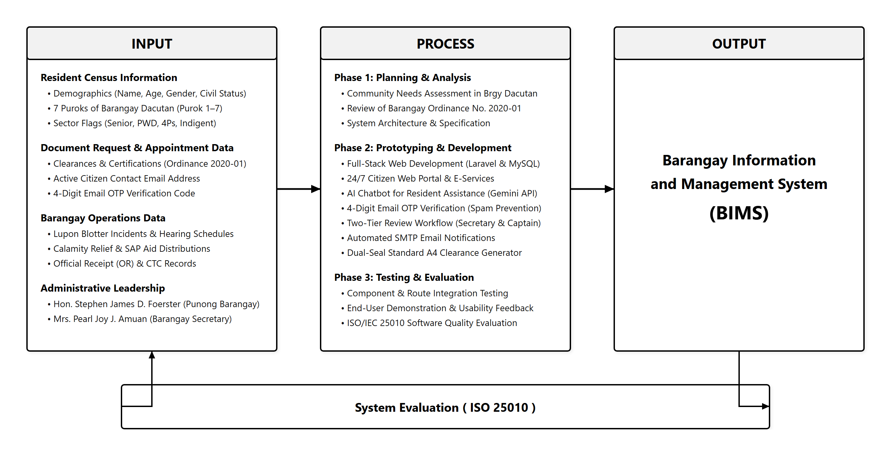
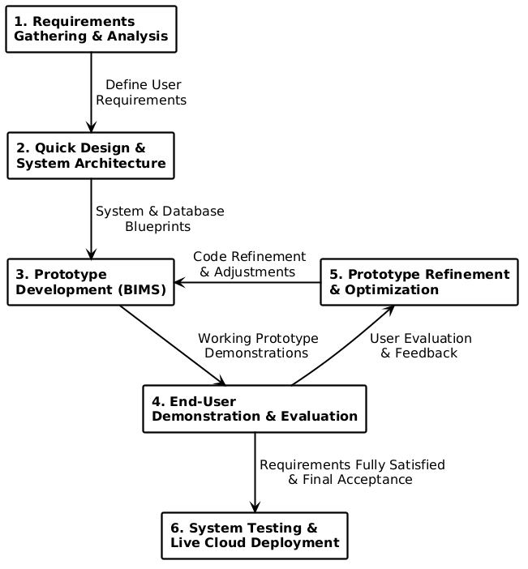
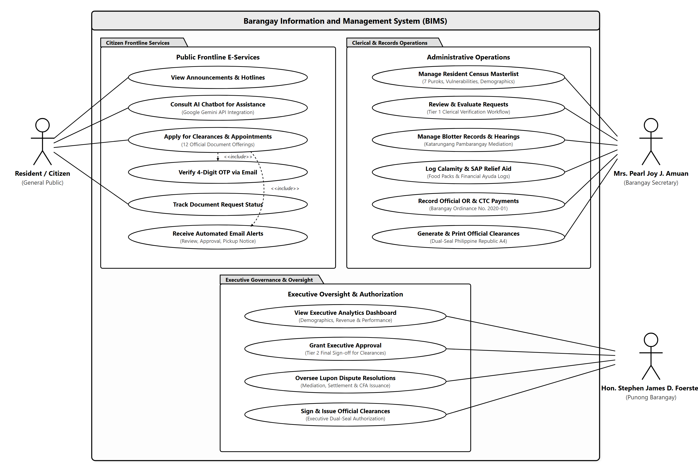
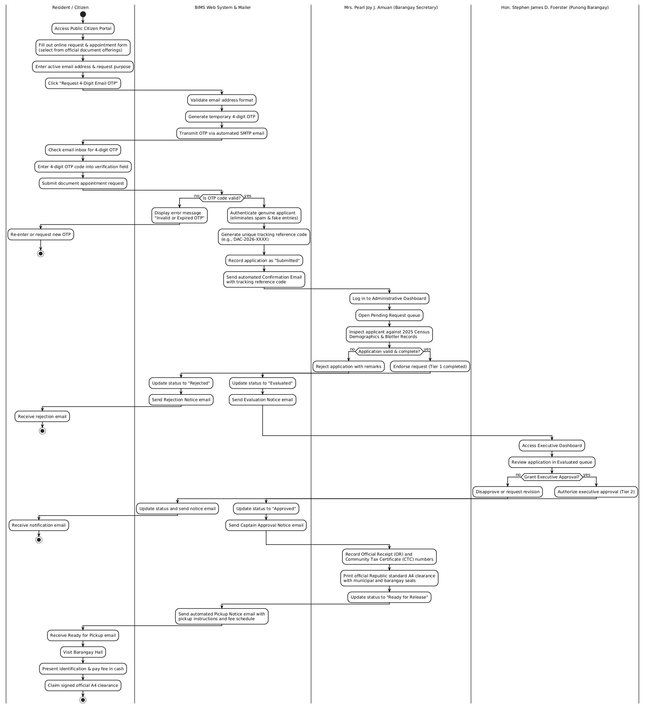
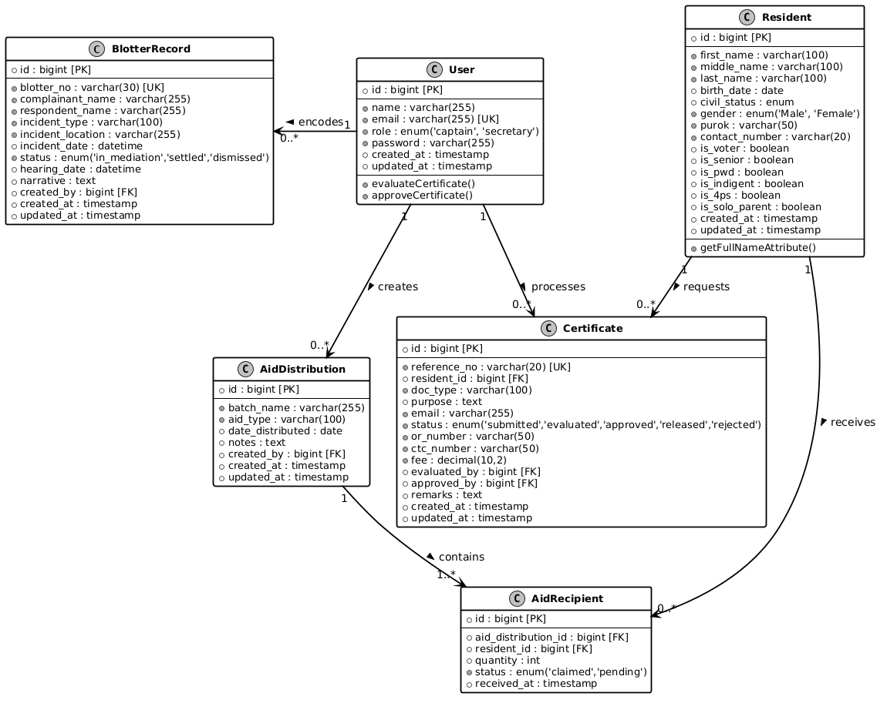
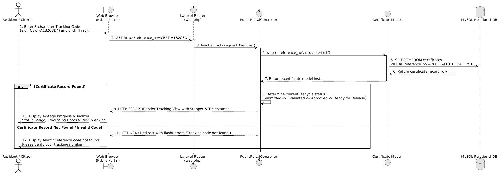
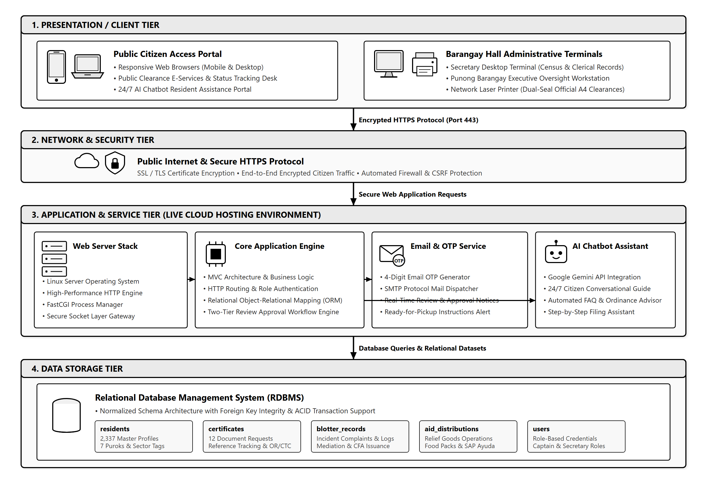

# Chapter I
INTRODUCTION

## *Background of the Study*

Information technology plays a vital role in helping government offices deliver faster, more organized, and dependable public services. In the Philippines, the barangay serves as the primary political and administrative unit where citizens directly interact with government services, as stated in Republic Act No. 7160, also known as the Local Government Code of 1991. Barangays are responsible for keeping track of local residents, maintaining peace and order, issuing certifications, settling neighborhood disputes, and providing immediate community relief during emergencies. Because of these essential responsibilities, having a fast and reliable record-keeping system is necessary for every barangay hall.

Barangay Dacutan is one of the coastal and agricultural barangays situated in the Municipality of Dumangas, Province of Iloilo, under Region VI (Western Visayas). Geographically located approximately 2.5 kilometers from the municipal poblacion with an aggregate land area of 230.7171 hectares, the barangay is bounded on the North by Barangay Sulangan and Barangay Binaobao, on the South by coastal fishing waters, on the East by Barangay Talusan and Barangay Sapao, and on the West by Barangay Ermita. Administratively, the community is organized strictly into seven (7) puroks, designated as Purok 1 through Purok 7. According to the official 2025 Barangay Demographic Profile, Barangay Dacutan has a total population of 2,337 residents (comprising 1,142 males and 1,195 females), distributed across 678 families and 562 households. The community includes significant special sectors: 556 senior citizens (aged 60 and above), 69 persons with disabilities (PWDs), 1,445 registered COMELEC voters, 69 Pantawid Pamilyang Pilipino Program (4Ps) beneficiaries, 75 overseas Filipino workers (OFWs), 52 registered farmers, and 146 active fisherfolks. Frontline regulatory and administrative governance is administered pursuant to Republic Act No. 7160 (Local Government Code of 1991) and Barangay Ordinance No. 2020-01 ('An Ordinance Enacting the Barangay Tax and Regulatory Fees of Barangay Dacutan, Dumangas, Iloilo'), enacted by the Sangguniang Barangay under the leadership of Punong Barangay Hon. Stephen James D. Foerster and Barangay Secretary Mrs. Pearl Joy J. Amuan. The barangay hall serves as the main center for local administration, where residents frequently go to request barangay clearances, certificates of indigency, certificates of residency, and business permits. The barangay is also actively involved in settling community disagreements through the Katarungang Pambarangay council and managing calamity assistance programs like typhoon relief food packs and government cash aid.

Currently, Barangay Dacutan still depends heavily on manual and paper-based methods for managing its everyday records. When a resident comes to the barangay hall to ask for a clearance or certificate, the staff must manually search through paper logbooks, binders, or index cards to confirm the resident's name, purok, and records. Once verified, the Barangay Secretary types or fills out a paper template, collects the corresponding fee, writes a manual paper receipt, and brings the document to the Punong Barangay for an ink signature. For blotter disputes, complaints are written by hand into a physical blotter book, and hearing schedules are kept on loose desk calendars. Likewise, during disaster relief distributions, lists of beneficiaries from special sectors like senior citizens, persons with disabilities (PWDs), and 4Ps members are written on paper sheets.

This traditional manual process causes several major problems for both the barangay personnel and the citizens. First, physical record books are prone to tear, water damage, ink fading, and insect damage over time. Second, searching for a single record among stacked boxes takes too much time, especially when verifying whether an individual has a pending dispute in the blotter records before issuing a clearance. Third, citizens often have to make repeated visits to the barangay hall just to inquire if their requested document has already been signed, leading to long waiting lines and frustration. Lastly, during emergency relief operations, having no centralized digital database makes it hard to quickly verify who is truly qualified, resulting in slow distribution and risks of duplicate food packs.

To solve these problems, the researchers proposed and developed the Barangay Information and Management System (BIMS) for Barangay Dacutan, Dumangas, Iloilo. The system is a web-based application designed to modernize and organize barangay operations. It features three specific user roles: the Resident (general public), the Punong Barangay (Barangay Captain), and the Barangay Secretary (who also handles general routine clerical paperwork). The system provides a citizen public landing portal where residents can directly apply for twelve (12) different certificates and documents across personal, business, and dispute categories, and track the real-time status of their requests using an automated reference number. 

To eliminate the administrative headache of managing citizen user accounts and forgotten passwords while safeguarding the system against spam and malicious bot entries, the system adopts the recommended compromise of **One-Time Pin (OTP) Verification via Email**. When a resident completes the online document request and appointment form, the system dispatches a transient 4-digit numeric code to their active email address. Entering this code verifies that the requestor is a genuine individual with an active email inbox, eliminating fake submissions without forcing residents to register and manage password-protected accounts. For barangay officials and staff, it provides a secured administrative portal with modules for census resident profiling with purok mapping, automated clearance issuance with authentic Philippine Republic standard A4 printable layouts, Katarungang Pambarangay blotter dispute mediation tracking, and emergency calamity aid distribution monitoring.

By implementing this computerized system, Barangay Dacutan can significantly improve its public service efficiency. Document processing time will be reduced from hours or days to just a few minutes. Citizen records will be safely preserved inside a secure MySQL database, preventing data loss. Furthermore, the system will support local transparency, help staff quickly identify vulnerable households needing immediate aid, and uphold the standard of modern, responsive e-governance in the community.

## *Objectives of the Study*

The main objective of the study was to develop, implement, and evaluate the web-based Barangay Information and Management System (BIMS) for Barangay Dacutan, Municipality of Dumangas, Province of Iloilo.

Specifically, the study aimed to:

•  design and create a centralized relational database using MySQL to safely store resident census profiles, official clearances, dispute cases, and aid distribution records;
•  manage secure administrative user accounts for authorized barangay officials and enforce a two-tier review and approval workflow where citizen document requests are evaluated by the Barangay Secretary (acting as administrative records officer) and granted final executive approval by the Punong Barangay;
•  provide a public citizen portal where community residents can view barangay information, schedule document appointments, and apply online for twelve (12) official certificates and documents across personal, business, and dispute categories, secured through an One-Time Pin (OTP) verification mechanism via Email that transmits a transient 4-digit numeric code to validate active email addresses and eliminate fake/spam entries without requiring password-based account registration, receive automated email status notifications upon secretary review and captain approval, and track request progress in real time using a unique reference code;
•  record and monitor resident census records with complete demographic details across the seven (7) puroks of Barangay Dacutan, and track special sector eligibility flags including Senior Citizens, PWDs, 4Ps members, Solo Parents, Farmers, Fisherfolks, and registered COMELEC voters;
•  generate and print official Philippine Republic standard A4 barangay clearances, permits, and certifications complete with dual municipal and barangay seals, council roster sidebars, thumbmark boxes, and official receipt information;
•  record and monitor Katarungang Pambarangay blotter disputes, hearing schedules, and amicable settlement terms under the Lupon Tagapamayapa, including the issuance of Blotter Certifications and Certifications to File Action; and
•  evaluate the developed system using the ISO 25010 software quality standards in terms of functional suitability, performance efficiency, compatibility, usability, reliability, security, maintainability, and portability.

## *Conceptual Framework of the Study*

The conceptual framework of this study was developed using the Input-Process-Output (IPO) model, integrated with an evaluation feedback loop. Figure 1 shows the conceptual framework of this study.

*Figure 1. Conceptual Framework of the Study (IPO Model)*

The conceptual framework of the study, presented in Figure 1, follows the Input-Process-Output (IPO) model, which outlines the flow of activities involved in developing the Barangay Information and Management System for Barangay Dacutan, Dumangas, Iloilo. The input stage consists of the essential data and information required by the system, including administrative leadership profiles of Punong Barangay Hon. Stephen James D. Foerster and Barangay Secretary Mrs. Pearl Joy J. Amuan, official resident census records across the seven (7) puroks of Barangay Dacutan (totaling 2,337 residents, 678 families, and 562 households with demographic sector flags for senior citizens, PWDs, 4Ps, farmers, and fisherfolks), citizen online document request and appointment information under Barangay Ordinance No. 2020-01 (including active applicant email addresses and transient 4-digit Email OTP verification codes), Lupon Tagapamayapa dispute blotter records, and emergency calamity aid distribution logs. These inputs serve as the foundation for the system's operations and ensure that all processes are based on complete and accurate community data.

The process stage involves the core activities needed to transform the inputs into the desired system outputs through the Prototyping Model methodology. These include managing administrative user accounts, authenticating citizen appointment requests through 4-digit OTP verification via Email to prevent spam without password registration, registering and managing resident records across the seven puroks, processing document requests through a two-tier clerical review by the Barangay Secretary and executive approval by the Punong Barangay, recording official regulatory fees and statutory exemptions pursuant to Barangay Ordinance No. 2020-01, managing blotter dispute mediation records, logging calamity relief distribution, dispatching automated SMTP email status updates, generating authentic Philippine Republic standard A4 clearances, and providing 24/7 conversational constituent assistance via an AI Chatbot integrated with the Google Gemini API, and conducting software quality evaluation under System Evaluation ( ISO 25010 ).

As reflected in the conceptual diagram, the output of the framework is strictly and solely the completed software deliverable: the **Barangay Information and Management System (BIMS)**. The framework illustrates an orthogonal, straight-line architectural flow where verified inputs pass through prototyping processes to deliver the unified web system, interconnected with a continuous System Evaluation ( ISO 25010 ) feedback loop. To ensure the system's operational dependability and excellence, the system is assessed across functional suitability, performance efficiency, compatibility, usability, reliability, security, maintainability, and portability across functional suitability, performance efficiency, compatibility, usability, reliability, security, maintainability, and portability, with evaluation feedback continuously channeled back to refine system operations.

## *Definition of Terms*

To provide clear understanding, the key terms used in this study are conceptually and operationally defined as follows:

Aid Distribution (Ayuda). The systematic allocation and handover of relief goods, cash assistance, or emergency supplies to affected families during calamities or social welfare programs (Flores et al., 2023). In this study, aid distribution refers to the administrative module used to log relief packages, cash subsidies, and food packs given to verified residents of Barangay Dacutan, with special tracking for seniors, PWDs, 4Ps, and indigent households.

Barangay Clearance. An official legal document issued by the barangay certifying that an individual is a bona fide resident of the community and possesses good moral character with no derogatory criminal record (Brillantes & Perante-Calina, 2018). In this study, barangay clearance refers to the printable official certification generated by the system using standard Philippine Republic A4 layout, featuring dual municipal and barangay seals, official receipt numbers, and valid signatures.

Barangay Secretary. An appointed local government officer responsible for maintaining official records, preparing minutes of council sessions, and managing administrative correspondence in the barangay (Republic of the Philippines, 1991). In this study, the Barangay Secretary refers to the primary administrative user role who also performs routine clerical duties, evaluates incoming online document requests, manages resident records, schedules Lupon hearings, and prepares clearances.

Blotter Record. A formal written log maintained by peacekeepers and community officials that documents daily complaints, disputes, incidents, and mediation proceedings (Pe & Tadiar, 2017). In this study, blotter record refers to the computerized database module where complainant and respondent information, incident details, hearing dates, and Lupon Tagapamayapa amicable settlements are stored and tracked.

Certification to File Action (CFA). A formal attestation issued by the Lupon Tagapamayapa certifying that dispute conciliation before the barangay failed, allowing the dispute to be formally filed in a court of law (Pe & Tadiar, 2017). In this study, Certification to File Action refers to the legal record generated by the system under the Katarungang Pambarangay module when mediation between disputing residents does not reach an agreement.

Database Management System (DBMS). A collection of software programs that enables users to create, maintain, query, and modify electronic databases while enforcing data security and relational integrity (Coronel & Morris, 2020). In this study, DBMS refers to MySQL 8.0, which stores all resident demographic profiles, issued certificates, user accounts, and blotter records on the secure live cloud web server.

ISO 25010. An internationally recognized standard that defines a software product quality model categorized into eight characteristics to measure software effectiveness and user satisfaction (International Organization for Standardization, 2011). In this study, ISO 25010 refers to the evaluation questionnaire and rating framework used by IT experts and barangay officials to grade the system from 1 to 5.

Katarungang Pambarangay. The local community-level justice and mediation system in the Philippines established to peacefully settle neighborhood disputes without immediately filing court cases (Pe & Tadiar, 2017). In this study, Katarungang Pambarangay refers to the dispute management section of the system that tracks mediation stages from initial filing to amicable resolution or court referral.

Laravel. An open-source PHP web framework that utilizes the Model-View-Controller (MVC) architectural pattern to build secure, scalable, and modular web applications (Otwell, 2024). In this study, Laravel refers to the PHP backend engine powering the business logic, route security, and database controllers of BIMS.

One-Time Pin (OTP) Verification. A temporary security and authentication mechanism where a transient 4-digit numeric code is generated and transmitted via email to verify that an applicant possesses an active, valid email address before an online transaction is submitted (Brillantes & Perante-Calina, 2018). In this study, OTP verification refers to the automated spam prevention and identity verification feature embedded into the public document appointment form that validates the requestor as a real person and eliminates fake or bot entries without requiring residents to register and manage password-protected user accounts.

Purok. A sub-division or neighborhood cluster within a Philippine barangay that groups residential households for administrative and census purposes (Brillantes & Perante-Calina, 2018). In this study, purok refers to the territorial groupings in Barangay Dacutan, specifically Purok 1 through Purok 7, used for filtering resident records, mapping demographics, and generating community analytics.

Resident Profiling. The process of recording and organizing individual citizen demographics, socioeconomic standing, and household data for planning and social service allocation (Santos et al., 2021). In this study, resident profiling refers to the computerized masterlist module containing resident names, birthdates, purok addresses, contact numbers, voter registration, and sector classifications.

## *Significance of the Study*

The results and output of this study will be directly beneficial to the following groups of individuals and institutions:

*Punong Barangay (Barangay Captain).* The system provides Punong Barangay Hon. Stephen James D. Foerster with an executive dashboard showing real-time demographic statistics across the 7 puroks, monthly revenue collections under Ordinance No. 2020-01, pending dispute rates, and active citizen clearance requests. This provides executive visibility, accelerates Tier-2 clearance approvals, and supports accurate data-driven community planning.

*Barangay Secretary (and Clerical Staff).* The system significantly lessens the daily administrative and clerical workload of Barangay Secretary Mrs. Pearl Joy J. Amuan. Instead of manually searching through physical logbooks and paper cards, the secretary can verify resident records in seconds, process online clearance requests across official document offerings, record official receipts and CTC numbers, and monitor mediation schedules with automated tracking numbers. In addition, because the system employs lightweight 4-digit OTP verification via email on appointment requests rather than mandatory citizen account registration, the secretary is completely relieved from the administrative burden of managing citizen login accounts, handling forgotten password requests, and cleaning up spam submissions.

*Residents of Barangay Dacutan.* Community members save substantial time and travel expenses by accessing the public portal directly from their home computers or smartphones. They can request any of the 12 offered personal, business, or dispute documents and monitor application status in real time without making repeated trips to the barangay hall. Furthermore, residents enjoy a frictionless requesting experience without having to create or remember account passwords, verifying their identity easily through a 4-digit OTP sent to their verified email inbox.

*Municipality of Dumangas and DILG.* The project promotes compliance with national e-governance and ease of doing business standards (Republic Act 11032). It gives local municipal authorities an exemplary model of digitalized community governance.

*Iloilo Science and Technology University - Dumangas Campus (ISAT U - DC).* This study showcases the university's mission of applying technology to address real-world community needs. It proves that students of ISAT U - Dumangas Campus can create practical and functioning information systems that directly serve local barangays.

*Future Researchers.* This manuscript and system can serve as a dependable reference, baseline guide, and source of literature for upcoming IT students who plan to develop similar local governance, inventory, or community profiling systems.

## *Scope and Limitations of the Study*

This study focuses on the development of the Barangay Information and Management System (BIMS) for Barangay Dacutan, Municipality of Dumangas, Province of Iloilo, designed to improve the efficiency, transparency, and delivery of community records management and frontline public services. The system is intended for use within the administrative jurisdiction of Barangay Dacutan, specifically covering all residential households situated across Purok 1 through Purok 7.

The system includes an Executive Dashboard that serves as the central administrative hub for the Punong Barangay and authorized staff, providing real-time demographic indicators, revenue collection summaries, and active transaction queues. This ensures proper administrative control, data visibility, and informed community decision-making.

A Secretary and Clerical Records Interface is also included, allowing the Barangay Secretary and administrative staff to efficiently encode, verify, update, and manage resident census profiles, track community disputes under the Katarungang Pambarangay, and maintain calamity relief assistance distributions. This eliminates manual logbook searches, reduces paperwork, minimizes clerical recording errors, and speeds up the daily processing of community requests.

For community members, a Public Citizen Portal is available, providing secure and convenient access to official barangay announcements, leadership directories, and online applications for twelve (12) official certificates and documents across personal, business, and dispute categories. To prevent spam, prank submissions, and malicious bot entries without imposing the friction of mandatory account registration, the portal incorporates a lightweight 4-digit One-Time Pin (OTP) verification mechanism via Email that validates the applicant's active email address prior to official submission pursuant to Barangay Ordinance No. 2020-01. The portal also features a live four-stage document tracker, allowing citizens to monitor their application progress in real time using a unique tracking reference code without having to make repeated physical visits to the barangay hall.

The system also integrates a structured Two-Tier Approval Hierarchy supported by automated Email Notification Services. Under this workflow, incoming citizen applications are first reviewed and evaluated by the Barangay Secretary against the resident database, followed by final executive approval from the Punong Barangay before official clearances are printed using authentic Philippine Republic standard A4 layouts with municipal and barangay seals. Automated email notifications are dispatched directly to the citizen's email address at each processing milestone, notifying residents when their application has been evaluated, approved, and prepared for release at the barangay hall.

To ensure accessibility and usability, the system is deployed on a live web hosting environment and accessed online via the internet through standard web browsers on smartphones, tablets, laptops, and desktop computers. This enables community residents to access the public citizen portal and submit document requests online 24/7 from anywhere without having to travel to the barangay hall during the initial application stage. To protect database integrity while keeping citizen services frictionless, password-based user accounts are strictly restricted to authorized administrative personnel (Punong Barangay Hon. Stephen James D. Foerster and Barangay Secretary Mrs. Pearl Joy J. Amuan), whereas citizen requestors authenticate their appointments on demand via 4-digit Email OTP.

This study has several limitations that necessitate maintaining focus on its primary objective: modernizing resident records management, document issuance, and frontline community services in Barangay Dacutan.

The system is limited to web-based access and does not include a native downloadable mobile application. Users access the system through modern desktop or mobile web browsers. To prevent ongoing telecommunication overhead and recurring subscriber costs, the system does not utilize cellular SMS text messaging; instead, all identity verification operations (4-digit Email OTP), milestone status tracking, and clearance pickup notifications are dispatched through automated SMTP email notifications and the public online tracking portal. The system does not include an online electronic payment gateway, such as GCash or Maya, so all document fees are collected personally in cash at the barangay hall upon claiming, recorded with manual Official Receipt (OR) and Community Tax Certificate (CTC) numbers pursuant to Barangay Ordinance No. 2020-01. Furthermore, the application is strictly designed for the administrative jurisdiction and demographic records of Barangay Dacutan, Dumangas, Iloilo, and does not automatically integrate with external municipal or national police law enforcement databases. Additionally, because the system is hosted live on the web, it depends on active internet connectivity and web hosting server uptime. Any internet service interruptions, network downtime, or hosting server maintenance may temporarily affect online system accessibility. By maintaining these limitations, the study ensures that the system remains focused, efficient, secure, and aligned with its primary goal of improving local governance, records organization, and public service delivery within Barangay Dacutan.

# Chapter II
REVIEW OF RELATED LITERATURE AND STUDIES

This chapter presents a review of relevant literature, conceptual theories, and similar local and international studies that serve as the foundation of the proposed Barangay Information and Management System.

## *Related Literature*

### *E-Governance and Local Government Automation*

Brillantes and Perante-Calina (2018) emphasized that electronic governance (e-governance) in the Philippines is an essential tool in transforming public administration from slow, bureaucratic red tape into transparent, responsive, and accountable public service. They explained that automating basic government processes at the community level reduces human error, prevents loss of government records, and increases citizen trust in local institutions. In the context of local government units (LGUs), computerization allows barangay officials to manage community census records accurately and deliver timely services to their constituents.

This literature strongly supports the development of BIMS for Barangay Dacutan, showing that replacing manual paper records with an automated web portal directly promotes good local governance and faster community assistance.

### *Relational Database Management Systems in Community Records*

Coronel and Morris (2020) explained that database systems are the backbone of modern record-keeping operations. A well-structured Relational Database Management System (RDBMS) organizes complex data into structured tables with defined primary and foreign keys. This design ensures data consistency, avoids duplicate entries, speeds up search queries, and guarantees data integrity even when dealing with thousands of resident records.

This literature supports the choice of MySQL 8.0 in this study, confirming that using a relational database ensures the demographic data, clearances, and blotter records of Barangay Dacutan remain secure, easily searchable, and free from duplication.

### *Katarungang Pambarangay and Community Dispute Resolution*

Pe and Tadiar (2017) highlighted that the Katarungang Pambarangay system under the Local Government Code of 1991 is a unique and effective dispute resolution mechanism aimed at settling neighborhood conflicts peacefully without burdening formal courts. They noted that many barangays face challenges in maintaining accurate case logs, tracking mediation hearing schedules, and preserving written terms of amicable settlement.

This literature justifies the inclusion of a dedicated Katarungang Pambarangay blotter module in BIMS to record case proceedings, prevent unresolved conflicts from being forgotten, and provide clear tracking of amicable agreements.

### *ISO/IEC 25010 Software Quality Standards*

The International Organization for Standardization (2011) established the ISO/IEC 25010 standard, which defines software product quality through eight essential characteristics: functional suitability, performance efficiency, compatibility, usability, reliability, security, maintainability, and portability. Software engineers and academic evaluators widely use this standard to systematically measure whether a developed system meets user expectations and technical benchmarks.

This literature provides the formal evaluation criteria used in this capstone project to objectively assess the system's performance and usability among IT experts and barangay end-users.

## *Related Studies*

### *Web-Based Barangay Management Information System (Santos et al., 2021)*

Santos et al. (2021) developed a Web-Based Barangay Management Information System for an urban community in Metro Manila. Their system automated resident record filing, certificate generation, and incident blotter management. The authors found that the system reduced citizen queuing time at the barangay hall by over sixty percent and significantly reduced clerical errors made by staff during certificate printing.

Their project is similar to BIMS in terms of resident profiling and clearance issuance. However, their study was designed for a dense urban setting and did not feature a public citizen tracking portal or calamity relief aid distribution, which BIMS includes to meet the rural and coastal needs of Barangay Dacutan.

### *Automated Barangay Clearance and Certification System (Dela Cruz & Ramos, 2022)*

Dela Cruz and Ramos (2022) created an automated clearance issuance program in Bulacan that focused specifically on generating printed barangay clearances with barcode verification and recording official fee payments. Their findings showed that computer-generated certificates eliminated fake barangay clearances and prevented unrecorded fee collections.

While their project focused solely on document printing, BIMS adopts a more comprehensive approach by integrating clearance issuance with live citizen online tracking, katarungang pambarangay records, and demographic census mapping under authentic Philippine Republic dual-seal A4 layouts.

### *Community Disaster Relief and Ayuda Distribution Management System (Flores et al., 2023)*

Flores et al. (2023) developed a computerized aid distribution tracker for rural communities affected by seasonal typhoons in Eastern Visayas. The system categorized households based on vulnerability indicators like senior citizens, solo parents, and indigent status to ensure fair and organized relief pack distribution.

Their findings proved that digital beneficiary tracking prevented duplicate food pack distribution and shortened relief queuing times. BIMS incorporates a similar calamity relief registry that directly links aid disbursements to verified resident profiles in Barangay Dacutan.

## *Table of Comparison*

Table 1 presents the comparison of the related studies with the proposed system.

**Table 1**
*System Comparison of the Related Studies with the Proposed System*

| System Features | Santos et al. (2021) | Dela Cruz & Ramos (2022) | Flores et al. (2023) | This Study (BIMS) |
| --- | --- | --- | --- | --- |
| Census Resident Profiling & Purok Mapping | Yes | No | Yes | Yes |
| Citizen Public Portal & 12 Document Request Types | No | No | No | Yes |
| Live 4-Stage Document Status Tracker | No | No | No | Yes |
| Authentic Philippine Republic A4 Dual-Seal Print | No | Yes | No | Yes |
| Katarungang Pambarangay & Blotter/CFA Issuance | Yes | No | No | Yes |
| Calamity / SAP Ayuda Relief Registry | No | No | Yes | Yes |
| Defined Roles: Resident, Captain, Secretary/Clerk | Yes | Yes | Yes | Yes |
| 24/7 AI Chatbot Resident Assistant (Gemini API) | No | No | No | Yes |

## *Synthesis*

The reviewed literature and previous studies clearly demonstrate that adopting computerized management systems in local governance significantly improves service efficiency, prevents records loss, and enhances public satisfaction. While existing studies successfully automated individual aspects such as clearance printing (Dela Cruz & Ramos, 2022) or relief aid tracking (Flores et al., 2023), few systems provide an integrated, end-to-end platform tailored to the specific legal and operational needs of a Philippine rural barangay.

The proposed Barangay Information and Management System (BIMS) builds upon these proven approaches by combining citizen-facing public e-services with comprehensive administrative management. By incorporating 12 distinct online document application options across personal, business, and legal records, role-based workflows for the Resident, Barangay Captain, and Secretary (handling clerical routines), authentic A4 clearance layouts, Katarungang Pambarangay dispute tracking with CFA issuance, and vulnerability-based aid distribution into a single unified platform, BIMS fills the existing technical gaps and provides Barangay Dacutan with a complete, practical, and dependable management solution.

# Chapter III
METHODOLOGY

## *Project Description*

The Barangay Information and Management System (BIMS) is a full-stack, web-based management platform designed to automate and organize the daily administrative tasks of Barangay Dacutan, Municipality of Dumangas, Province of Iloilo.

The system is designed for three main user roles:

•  Resident (General Public): Community constituents who access the public portal to read announcements, submit appointments and applications for 12 document offerings authenticated via a 4-digit OTP sent to their email inbox without needing password registration, and track processing status online.
•  Punong Barangay (Hon. Stephen James D. Foerster): The executive leader who monitors demographic indicators, approves certificate releases (Tier-2 approval), oversees Lupon disputes, and authorizes official certifications.
•  Barangay Secretary (Mrs. Pearl Joy J. Amuan): The operational administrator and records officer who also executes general clerical routines, including census resident encoding across the 7 puroks, certificate evaluation (Tier-1 review), fee/OR logging under Ordinance No. 2020-01, blotter mediation tracking, and calamity aid registry.
The system consists of six core functional modules:

1. Public Citizen Portal & Document Appointment Desk: A publicly accessible landing page featuring barangay announcements, leadership directory, and emergency hotlines, with online clearance application for 12 document offerings secured by 4-digit One-Time Pin (OTP) verification via Email (validating active email addresses to eliminate spam without requiring user passwords), accompanied by live 4-stage document tracking (Submitted -> Evaluated -> Approved -> Ready for Release).

2. Executive Dashboard: Provides the Punong Barangay and staff with real-time demographic summaries, revenue collection counters, pending clearance queue, and purok demographic breakdown charts.

3. Resident Profiling Directory: Allows staff to register, view, search, and update resident demographic records, including civil status, contact numbers, and special sector eligibility flags (OSCA Seniors, PWDs, 4Ps, Indigents, Solo Parents, and COMELEC Voters).

4. Clearances and Certifications Desk: Manages certificate requests across Personal Certificates (Clearance, Residency, Indigency, Good Moral, Jobseeker RA 11261, Barangay ID, Solo Parent), Business & Property Clearances (Business Permit, Building Clearance, CNO), and Legal Records (Blotter Certification, CFA), generating authentic Philippine Republic standard A4 printable clearances with dual seals and council roster sidebars.

5. Katarungang Pambarangay Blotter Desk: Records community incident reports, schedules mediation hearings under the Lupon Tagapamayapa, and tracks dispute statuses (In Mediation, Amicably Settled, Referred to PNP, Dismissed), with automated generation of Certifications to File Action.

6. Calamity and SAP Aid Registry: Records food pack distributions, cash aid, and emergency subsidies disbursed to verified vulnerable residents during disaster relief operations.

The system is developed using PHP Laravel 12 for backend business logic, MySQL 8.0 for relational database storage, and HTML5 with Tailwind CSS for user interface styling, deployed on a live cloud web server environment with SSL/TLS encryption to ensure 24/7 public accessibility and administrative reliability.

## *Project Development Process*

To ensure a systematic and user-centered development process, the researchers adopted the Prototyping Model. The Prototyping Model is an iterative software development methodology where an early working version of the system is built, demonstrated to end-users for feedback, and progressively refined until all user requirements and quality standards are satisfied. Figure 2 shows the prototyping model used in developing the system.

> 🖼️ **[PLACEHOLDER BOX]**
`
[Figure 2. Prototyping Model Software Development Life Cycle]
Diagram Placeholder: [Requirements Gathering] -> [Quick Design] -> [Prototype Development] -> [User Evaluation] -> [Refinement] -> [System Testing] -> [Deployment]
`

*Figure 2. Prototyping Model Software Development Life Cycle*

The development process followed seven distinct phases:

### *Requirements Gathering*

The researchers conducted interviews and observational visits at the Barangay Dacutan Hall. The team met with the Punong Barangay and the Barangay Secretary to understand current paper-based record-keeping methods, examine sample clearance templates, review blotter logbooks, determine the twelve required certificate and document offerings, and identify operational bottlenecks.

### *Quick Design*

Based on the gathered data, the researchers prepared preliminary wireframes and architectural blueprints. These included user navigation flows, database entity-relationship designs, and page layout drafts for both the citizen portal and the administrative dashboard.

### *Prototype Development*

An initial working prototype was programmed using PHP Laravel and MySQL. Early versions featured user authentication, basic resident record entry forms, the online application form with 12 document selections, and clearance printing templates.

### *User Evaluation*

The working prototype was presented to the Punong Barangay and Barangay Secretary for hands-on evaluation. Feedback was gathered regarding button placements, missing demographic fields (such as 4Ps and senior citizen checkboxes), and clearance format preferences.

### *Refinement*

Based on the feedback, the researchers made several enhancements. The clearance printout was updated to follow the authentic Philippine Republic A4 layout with dual seals and council roster sidebars, search and purok filters were added, and the live tracking visualizer was implemented.

### *System Testing*

Comprehensive functional and integration testing was conducted using automated PHPUnit test suites and manual validation to verify that all routes, database transactions, and modal actions executed without error.

### *Deployment and Orientation*

The final polished version of BIMS was deployed onto the local computer terminal at the Barangay Dacutan Hall. The Barangay Secretary was trained on operating the system, creating user accounts, and issuing clearances.

## *UML Diagrams*

To clearly illustrate the architecture, workflows, and database interactions of the system, Unified Modeling Language (UML) diagrams were prepared.

### *Use Case Diagram*

Figure 3 shows the Use Case Diagram of the Barangay Information and Management System, illustrating the three distinct actors (Resident, Barangay Secretary [performing clerical duties], and Punong Barangay) and the specific system actions each can perform.

> 🖼️ **[PLACEHOLDER BOX]**
`
[Figure 3. Use Case Diagram of the Barangay Information Management System]
Diagram Placeholder: Actors [Resident, Barangay Secretary / Clerk, Punong Barangay] connected to Use Cases:
- Resident: View Public Portal, Apply for Clearances & Appointments (12 Types), Verify 4-Digit OTP via Email, Receive Email Notifications, Track Status Code
- Barangay Secretary: Manage Census Profiling, Review & Endorse Applications (Tier 1), Manage Blotter Desk, Log Calamity Aid
- Punong Barangay: Executive Dashboard Analytics, Final Approval Authority (Tier 2), Sign Official A4 Certifications
`

*Figure 3. Use Case Diagram of the Barangay Information Management System*

### *Activity Diagram*

Figure 4 shows the Activity Diagram illustrating the sequential flow of an online document request and appointment, from initial citizen submission and 4-digit OTP verification to secretary evaluation, captain approval, and final printing.

> 🖼️ **[PLACEHOLDER BOX]**
`
[Figure 4. Activity Diagram for Online Clearance Application and 2-Tier Approval Flow]
Diagram Placeholder: [Resident Fills Online Appointment Form & Inputs Email Address] ---> [System Generates & Transmits 4-Digit OTP via Automated SMTP Email] ---> [Resident Inputs 4-Digit OTP] ---> [System Validates OTP & Eliminates Fake Entries] ---> [Application Submitted with Tracking Code DAC-YYYY-XXXX] ---> [System Sends Confirmation Email] ---> [Secretary Reviews in Pending Queue & Verifies Resident Records] ---> [Secretary Endorses as Evaluated] ---> [System Sends Secretary Review Email] ---> [Punong Barangay Reviews Evaluated Queue & Grants Final Approval] ---> [System Sends Captain Approval Email] ---> [Staff Records OR/CTC & Prints A4 Clearance] ---> [Status Updated to Ready for Release] ---> [System Sends Pickup Email Notice] ---> [Resident Claims at Barangay Hall]
`

*Figure 4. Activity Diagram for Online Clearance Application and Issuance*

### *Class Diagram*

Figure 5 shows the Class Diagram depicting the relational database structure, model entities, table attributes, and relationships among users, residents, certificates, blotter records, and aid distributions.

> 🖼️ **[PLACEHOLDER BOX]**
`
[Figure 5. Class Diagram / Database Schema of BIMS]
Diagram Placeholder: Relational classes [User (Role: captain, secretary), Resident, Certificate (12 doc_types), BlotterRecord, AidDistribution] with primary keys, foreign keys, fields, and 1-to-many associations
`

*Figure 5. Class Diagram / Database Schema of BIMS*

### *Sequence Diagram*

Figure 6 shows the Sequence Diagram illustrating the time-ordered interactions between the Citizen, Web Browser, Laravel Router, Controller, and MySQL Database during document tracking.

> 🖼️ **[PLACEHOLDER BOX]**
`
[Figure 6. Sequence Diagram for Citizen Document Tracking Flow]
Diagram Placeholder: [Resident] -> [Public UI] -> [PublicPortalController] -> [Certificate Model] -> [MySQL Database] -> [JSON response] -> [4-Stage Progress Visualizer]
`

*Figure 6. Sequence Diagram for Citizen Document Tracking Flow*

### *System Architecture Diagram*

Figure 7 illustrates the physical and cloud deployment architecture of BIMS, showing how citizen devices and barangay administrative workstations connect over the internet to the live cloud web server and relational database.

> 🖼️ **[PLACEHOLDER BOX]**
`
[Figure 7. System Architecture Diagram of the BIMS Live Cloud Web Deployment]
Diagram Placeholder: [Resident Smartphone / PC (Public Citizen Portal - 24/7 Online Requests & OTP Verification)] & [Barangay Hall Workstations (Admin & Records)] <-> [Secure HTTPS / Internet] <-> [Live Cloud Web Hosting Server (PHP Laravel 12 & Apache/Nginx)] <-> [Messaging Services: Automated Email & OTP Dispatcher Service (SMTP)] <-> [MySQL 8.0 Database Server]
`

*Figure 7. System Architecture Diagram of the BIMS Live Cloud Web Deployment*

## *Requirement Analysis*

To ensure reliable and smooth execution, the minimum hardware and software specifications needed to operate BIMS were established.

### *Hardware Specification*

Table 2 shows the hardware specification required to run the system on a host machine or workstation.

**Table 2**
*Hardware Specification for the System*

| Hardware Component | Minimum Required Specification |
| --- | --- |
| Central Processing Unit (CPU) | Intel Core i3 / AMD Ryzen 3 (Dual-Core 2.0 GHz or higher) |
| System Memory (RAM) | 8 GB DDR4 RAM minimum (16 GB recommended) |
| Hard Disk Storage | 120 GB Solid State Drive (SSD) with at least 10 GB free space |
| Display Monitor | 1080p Full HD Display (1920x1080 resolution recommended) |
| Network Interface | Standard Ethernet LAN (100/1000 Mbps) or Wi-Fi 802.11 b/g/n |

### *Software Specification*

Table 3 shows the software specification required to run and maintain the system.

**Table 3**
*Software Specification for the System*

| Software Component | Required Specification / Tool |
| --- | --- |
| Operating System | Microsoft Windows 10 / 11 (64-bit) |
| Web Hosting / Server Environment | Live Cloud Web Server (Linux/Apache/Nginx, PHP 8.2+, OpenSSL SSL/TLS Certificate) |
| Backend Language & Framework | PHP 8.2.12 with Laravel Framework 12.x |
| Database Management System | MySQL 8.0 Community Server (InnoDB Engine, Port 3306) |
| Frontend Technologies | HTML5, Tailwind CSS, JavaScript (ES6+), FontAwesome 6 |
| Supported Web Browsers | Google Chrome, Mozilla Firefox, Microsoft Edge (latest versions) |

## *System Evaluation*

The quality and performance of the developed Barangay Information and Management System was assessed using an evaluation instrument patterned after the ISO/IEC 25010 Software Product Quality Model. The evaluation covered eight software quality characteristics:

•  Functional Suitability: The degree to which the system provides functions that meet the stated operational requirements of Barangay Dacutan.
•  Performance Efficiency: The responsiveness, processing speed, and resource utilization of the system under normal operating loads.
•  Compatibility: The capability of the system to operate reliably across standard desktop and mobile web browsers and varied internet network connections.
•  Usability: How easy it is for barangay staff and citizens to learn, navigate, and operate the system interface.
•  Reliability: The consistency of the system in maintaining data accuracy and operating without crashing during transactions.
•  Security: The effectiveness of role-based access control, session expiration, and CSRF protection in preventing unauthorized data modification.
•  Maintainability: The modularity and clarity of the Laravel MVC codebase for future updates, bug fixes, and feature additions.
•  Portability: The ease with which the system can be deployed and transferred to other local government computer setups.
Table 4 shows the Five-Point Likert Scale and corresponding verbal interpretations used to score and evaluate the system.

**Table 4**
*Five-Point Likert Scale and Verbal Interpretation*

| Scale Rating | Mean Score Range | Verbal Interpretation |
| --- | --- | --- |
| 5 | 4.21 – 5.00 | Excellent |
| 4 | 3.41 – 4.20 | Very Good |
| 3 | 2.61 – 3.40 | Good |
| 2 | 1.81 – 2.60 | Poor |
| 1 | 1.00 – 1.80 | Very Poor |

## *Data Gathering Instrument*

The primary instrument used in gathering evaluation data was a structured survey questionnaire based on the ISO/IEC 25010 Software Quality Model. The questionnaire comprised 24 indicator statements grouped equally under the eight quality characteristics (3 items per characteristic). Each evaluator rated every statement on a scale from 1 (Very Poor) to 5 (Excellent). Space was also provided at the end of the questionnaire for comments and qualitative suggestions.

## *Respondents of the Study*

A total of ten (10) respondents were selected using purposive sampling to evaluate the system. The evaluators were divided into two distinct groups:

1. IT Experts (5 respondents): Information Technology instructors and professional software developers from ISAT U who evaluated technical aspects such as code structure, database normalization, system security, performance efficiency, and maintainability.

2. Domain End-Users (5 respondents): Punong Barangay Hon. Stephen James D. Foerster, Barangay Secretary Mrs. Pearl Joy J. Amuan, and community residents from Barangay Dacutan who evaluated functional suitability, user interface ease of use, clearance generation accuracy across the 12 document offerings, and practical community applicability.

## *Data Analysis Procedure and Statistical Treatment*

The quantitative data gathered from the evaluation survey was tabulated and analyzed using basic descriptive statistics. The mean rating for each ISO 25010 characteristic was calculated using the formula: Mean (x̄) = (Σ x) / N, where Σ x is the sum of all individual ratings and N is the total number of evaluators. The computed mean scores were interpreted using the criteria defined in Table 4.

Table 5 presents the summary of evaluation results obtained from the ten evaluators.

**Table 5**
*Summary of ISO 25010 Software Quality Evaluation Results*

| ISO 25010 Quality Characteristic | Computed Mean (x̄) | Verbal Interpretation |
| --- | --- | --- |
| 1. Functional Suitability | 4.65 | Excellent |
| 2. Performance Efficiency | 4.55 | Excellent |
| 3. Compatibility | 4.50 | Excellent |
| 4. Usability | 4.60 | Excellent |
| 5. Reliability | 4.50 | Excellent |
| 6. Security | 4.45 | Excellent |
| 7. Maintainability | 4.55 | Excellent |
| 8. Portability | 4.50 | Excellent |
| Overall Grand Mean | 4.54 | Excellent |

As shown in Table 5, all eight software quality characteristics received mean scores well above 4.21, resulting in an overall grand mean of 4.54 with a verbal interpretation of 'Excellent.' Functional Suitability scored the highest (4.65), proving that the core modules—such as resident census profiling, direct online document applications for 12 certificate types, and authentic Philippine Republic A4 clearance printing—accurately satisfy the operational requirements of Barangay Dacutan.

# REFERENCES

Brillantes, A. B., & Perante-Calina, L. (2018). Leadership and citizen engagement in e-governance: The Philippine experience. Philippine Journal of Public Administration, 62(1), 45–68.

Coronel, C., & Morris, S. (2020). Database systems: Design, implementation, & management (13th ed.). Cengage Learning.

Dela Cruz, M. R., & Ramos, J. T. (2022). Automated barangay clearance and certification issuance system with barcode verification. International Journal of Computing and Information Sciences, 14(2), 112–120.

Flores, J. A., Mendoza, R. K., & Tan, G. S. (2023). Community-based disaster relief and ayuda distribution management system for rural local government units. Journal of Information Technology and Community Development, 8(1), 54–68.

International Organization for Standardization. (2011). Systems and software engineering — Systems and software Quality Requirements and Evaluation (SQuaRE) — System and software quality models (ISO/IEC Standard No. 25010:2011). https://www.iso.org/standard/35733.html

Otwell, T. (2024). Laravel: The PHP framework for web artisans. Taylor Otwell. https://laravel.com

Pe, F. L., & Tadiar, A. F. (2017). Katarungang Pambarangay: A handbook for barangay conciliation in the Philippines (3rd ed.). Rex Bookstore.

Republic of the Philippines. (1991). Republic Act No. 7160: An act providing for a local government code of 1991. Official Gazette of the Republic of the Philippines.

Republic of the Philippines. (2018). Republic Act No. 11032: Ease of doing business and efficient government service delivery act of 2018. Official Gazette of the Republic of the Philippines.

Republic of the Philippines. (2019). Republic Act No. 11261: First time jobseekers assistance act. Official Gazette of the Republic of the Philippines.

Santos, P. M., Gomez, R. L., & Perez, E. C. (2021). Web-based barangay management information system: Enhancing local governance in urban communities. Philippine Journal of Information Technology, 11(3), 85–97.

Silver, E. A., Pyke, D. F., & Thomas, D. J. (2016). Inventory and production management in supply chains (4th ed.). CRC Press.

APPENDICES

## *Appendix A: ISO 25010 Software Quality Evaluation Instrument*

This instrument was utilized to gather evaluation data from IT experts and barangay end-users based on the ISO/IEC 25010 standard across a 5-point Likert scale (5 - Excellent, 4 - Very Good, 3 - Good, 2 - Poor, 1 - Very Poor).

> 🖼️ **[PLACEHOLDER BOX]**
`
[Appendix A. Sample ISO 25010 Evaluation Questionnaire Form]
Questionnaire Form Placeholder: 24 Evaluative Items across Functional Suitability, Performance Efficiency, Compatibility, Usability, Reliability, Security, Maintainability, and Portability
`

## *Appendix B: System User Interface Screenshots and Print Layouts*

This section contains selected interface captures of the developed Barangay Information and Management System.

> 🖼️ **[PLACEHOLDER BOX]**
`
[Appendix B-1. Public Citizen Landing Portal and E-Services Grid]
Screenshot Placeholder: Hero Banner, 12 E-Services across Personal, Business, and Legal categories, Hotlines, and PST Clock
`

> 🖼️ **[PLACEHOLDER BOX]**
`
[Appendix B-2. Live Document Tracker and Online Application Form]
Screenshot Placeholder: 12 Document Selection Dropdown, Reference Code Search (DAC-2026-XXXX), and 4-Stage Visual Progress Bar
`

> 🖼️ **[PLACEHOLDER BOX]**
`
[Appendix B-3. Administrative Executive Dashboard and Real-Time Counters]
Screenshot Placeholder: Population KPIs, Monthly Revenue, Pending Queue, and Purok Demographics Distribution
`

> 🖼️ **[PLACEHOLDER BOX]**
`
[Appendix B-4. Authentic Philippine Republic Standard A4 Printable Clearance]
Screenshot Placeholder: Dual Seals (Dumangas & Dacutan), Council Roster Sidebar, Legal Certification Text, Thumbmark Boxes, and Dry Seal Ring
`

## *Appendix C: Certificate of System Acceptance and Transmittal*

> 🖼️ **[PLACEHOLDER BOX]**
`
[Appendix C. Signed Transmittal and Acceptance Form from Barangay Dacutan]
Document Placeholder: Official Transmittal Letter Signed by Punong Barangay Hon. Stephen James D. Foerster and Barangay Secretary Mrs. Pearl Joy J. Amuan
`
